# Azure CloudStore

[](https://github.com/nafsampson/Azure-CloudStore/actions/workflows/dotnet-ci.yml)
[](https://github.com/nafsampson/Azure-CloudStore/actions/workflows/deploy-apps.yml)
[](https://dotnet.microsoft.com/)
[](https://azure.microsoft.com/)
[](https://cloudstore-web-ejikat3k7myva.azurewebsites.net)

CloudStore is an electronics storefront built with ASP.NET Core MVC and .NET 10. It combines customer shopping, administrator tools, private file storage and asynchronous order processing on Microsoft Azure. A separate LocalDemo mode runs without an Azure subscription.

**[Open the live application](https://cloudstore-web-ejikat3k7myva.azurewebsites.net)** · **[Detailed setup and deployment guide](RUNNING.md)**

## Try the live demo

Use the shared customer account to browse products, manage a cart, place a demonstration order and follow its status:

| Field | Value |
| --- | --- |
| Username | `store-customer` |
| Password | `storecustomer!47#B` |

This is a public demonstration account shared by visitors; use sample information only. Administrator credentials are kept private. These credentials apply to the hosted demo, not LocalDemo.

Availability depends on the Azure for Students subscription. If the hosted application is unavailable, [run it locally](#run-locally).

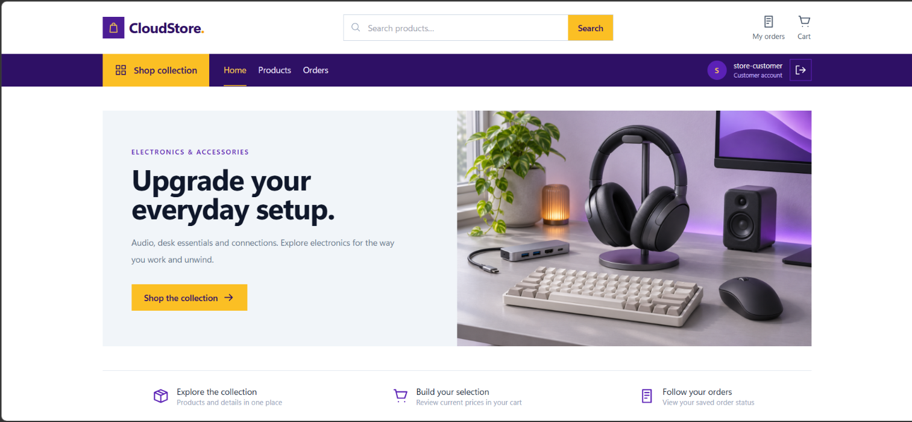

## Features

- **Customers:** browse six sample products, manage a cart, place orders and follow their status.
- **Administrators:** manage products and images, review orders, mark ready orders as processed, and upload or download contracts.
- **Background processing:** an Azure Functions queue trigger moves saved orders from Pending to Ready. An administrator completes the workflow by marking them Processed.
- **Private uploads:** product images use Blob Storage; contracts use Azure Files. The application handles authenticated file access.
- **Operations:** Application Insights telemetry, alert rules, a monitoring workbook and monthly budget notifications.

Prices and products are demonstration data. Checkout does not collect payments or arrange shipping.

## Architecture

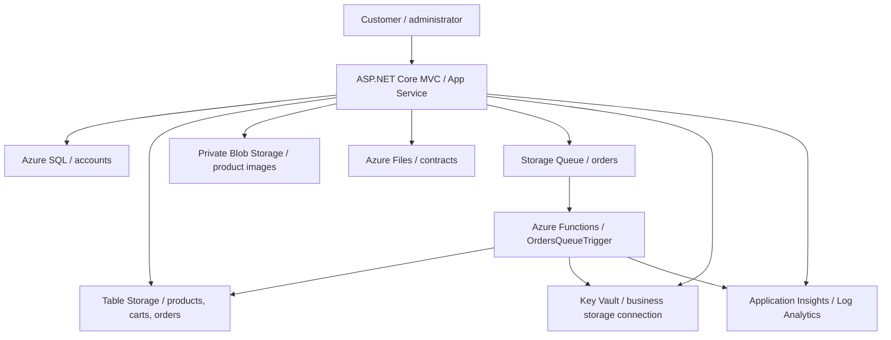

| Service | Responsibility |
| --- | --- |
| Azure App Service | Hosts the MVC storefront and administrator pages |
| Azure Functions, Flex Consumption | Processes queued orders independently of web requests |
| Azure SQL Database | Stores accounts, password hashes and authentication data |
| Azure Table Storage | Stores products, carts and orders |
| Azure Blob Storage | Stores all six catalogue product images privately |
| Azure Files | Stores uploaded contracts in the `contracts` share |
| Azure Queue Storage | Delivers order work to the Functions worker |
| Managed identities and Key Vault | Authenticate SQL access and resolve the business storage secret |
| Application Insights and Log Analytics | Record requests, exceptions and worker activity |

SQL authentication uses a user-assigned managed identity. Business storage currently uses an account-key connection string held in Key Vault; this is not a fully passwordless storage implementation. The Functions host uses a separate storage account.

## Order workflow

1. A customer adds a product to their cart and checks out.
2. The application saves a Pending order and dispatches queue work referring to that order.
3. `OrdersQueueTrigger` validates the saved order and conditionally updates it to Ready.
4. The customer and administrator can see the updated status.
5. An administrator marks the order Processed.

Repeated queue deliveries do not downgrade Ready or Processed orders. Conditional ETag updates protect against concurrent changes. Checkout retries use stable order identifiers, and cart removal checks the captured row version. Failed queue processing is retried by the Functions host, with a maximum dequeue count of five before poison-queue handling.

<details>
<summary>See the captured order workflow</summary>

**Customer checkout: Pending**

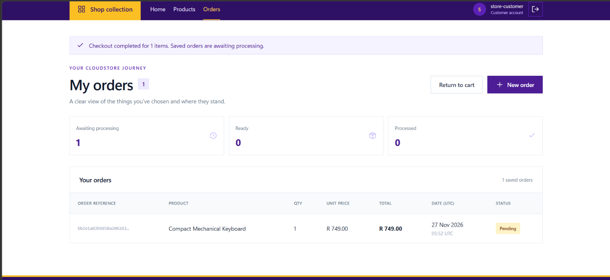

**Worker processing: Ready**

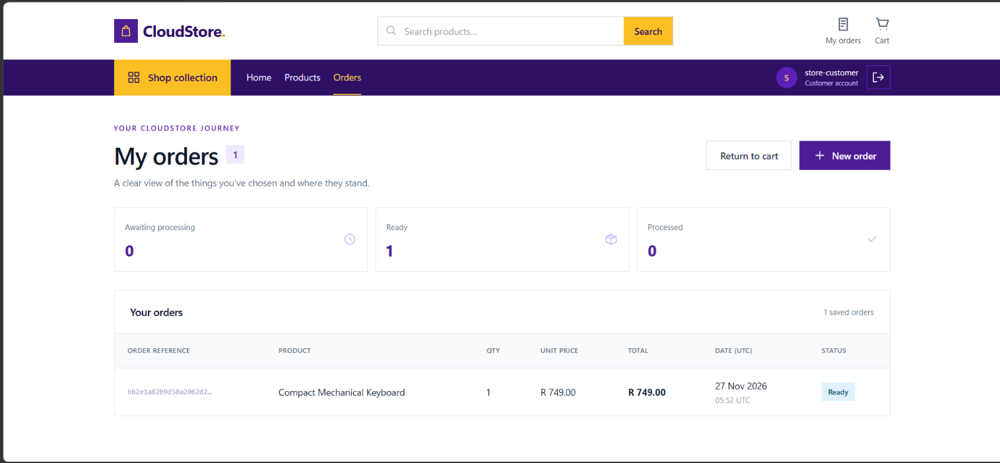

**Administrator completion: Processed**

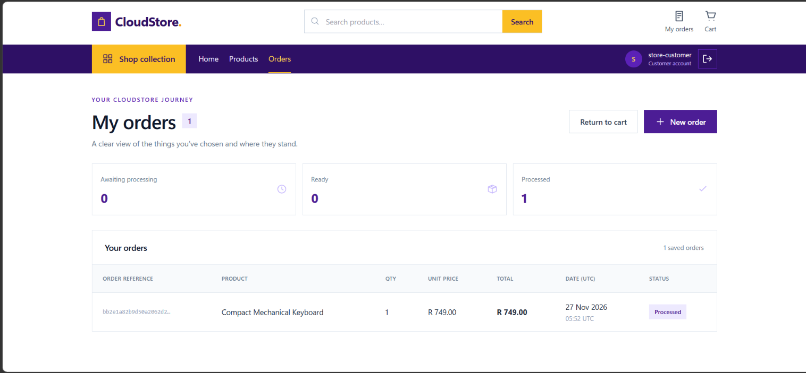

**Persisted Azure record** — the corresponding Table Storage row shows `Status=Processed` and `QueueStatus=Sent`.

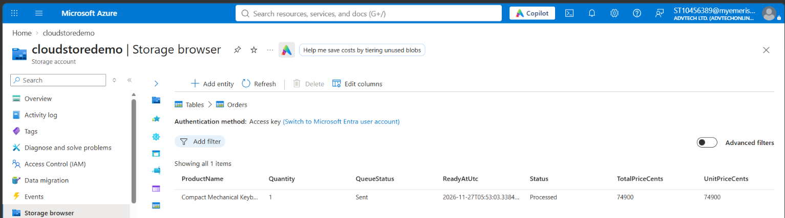

</details>

## Run locally

Install the .NET 10 SDK. From the directory containing `CloudStore.slnx`, run:

```powershell
dotnet build src/CloudStore.Web --configuration Release --maxcpucount:1
dotnet run --project src/CloudStore.Web --configuration Release --no-build --launch-profile LocalDemo -- demo-setup
dotnet run --project src/CloudStore.Web --configuration Release --no-build --launch-profile LocalDemo
```

Open **http://127.0.0.1:5267/Login/Index**.

The setup command prompts for separate passwords for `demo-admin` and `demo-customer`. Use 12–256 characters including uppercase, lowercase, a number and punctuation. There are no default passwords. Rerunning setup preserves existing accounts and data.

LocalDemo uses SQLite, private local files and a background worker. It needs no Azure credentials, Docker, SQL Server installation or local Functions host. Its accounts are separate from the hosted application's accounts. Local state is kept in `src/CloudStore.Web/.local-demo` and excluded from source control.

Catalogue images are supplied in `sample-data/catalog` and imported into private storage. They are not served as bundled website product images. Compiled CSS is included, so Node.js is only needed when rebuilding styles.

## Azure deployment

The deployed environment uses South Africa North, an App Service web application and a Linux Flex Consumption Functions worker. Infrastructure is defined in [Bicep](infra/main.bicep), with [monitoring resources](monitoring) and a [restricted SQL access script](database/GrantManagedIdentity.sql).

Follow [RUNNING.md](RUNNING.md) for configuration, SQL migrations, account setup, publishing and recovery. Replace environment-specific resource names, budget dates and notification settings before deploying your own environment. Review an infrastructure what-if before applying changes.

### GitHub Actions

| Workflow | Trigger | Purpose |
| --- | --- | --- |
| [CI](.github/workflows/dotnet-ci.yml) | Push or pull request to `main` or `master`; manual run | Compiles infrastructure, builds the solution and runs tests |
| [Application deployment](.github/workflows/deploy-apps.yml) | Manual run from `main` | Builds, tests and publishes the website and Functions worker to Azure |
| [Infrastructure deployment](.github/workflows/infrastructure.yml) | Manual run from `main` | Previews Bicep changes; an optional apply uses a separate environment |

[CI](https://github.com/nafsampson/Azure-CloudStore/actions/workflows/dotnet-ci.yml) and [manual application deployment](https://github.com/nafsampson/Azure-CloudStore/actions/runs/45986811389) have completed successfully. Pushing to `main` runs verification; it does not deploy the application. To release an update, choose **Actions → Deploy reviewed CloudStore apps → Run workflow → main**.

Deployment authenticates through OpenID Connect and the `azure-production` environment, without a stored Azure client secret. A new installation needs its own environment variables, federated trust and app-scoped role assignments. Match the Azure trust subject to GitHub's emitted subject, including owner and repository IDs where present; review it after a repository rename. Infrastructure deployment requires separate setup and is not part of an application release.

## Security and operational boundaries

- Role-based authorization separates Admin and Customer actions; customer data access checks ownership.
- Passwords use ASP.NET Core Identity hashing. Disabled accounts and password resets invalidate existing sessions through security-stamp checks.
- Login rate limiting and anti-forgery protection cover authentication and form submissions.
- Image uploads validate content, dimensions and size; contracts accept PDF or UTF-8 text. The maximum upload size is 4 MiB. Format validation is not malware scanning.
- SQL access is restricted to the application's required account tables. Infrastructure secrets and local account databases are excluded from the source package; the shared customer demo login above is intentionally public.
- `/health/live` checks that the web process responds; it does not verify SQL, storage or worker readiness.

Monitoring evidence confirms telemetry from both applications and enabled web/order failure rules. The notification email was verified, but end-to-end alert email delivery remains unverified: Azure rejected the action-group test with `Free subscription not supported`.

The deployed budget is **$10 per month**, with notifications at 80% actual spend and 100% forecast spend. A budget sends notifications; it does not stop resources or cap charges. Resource usage consumes the subscription's available credit or applicable billing allowance.

<details>
<summary>See Azure deployment and monitoring evidence</summary>

Screenshots captured on 27 November 2026 show the deployed environment. Telemetry totals include earlier troubleshooting requests and are not an uptime measurement.

**Resource group**

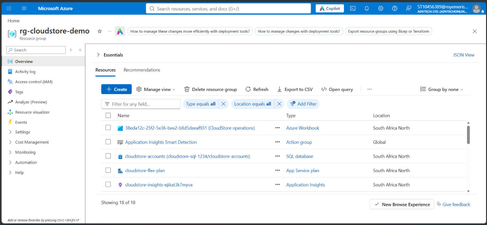

**Private product images: six blobs**

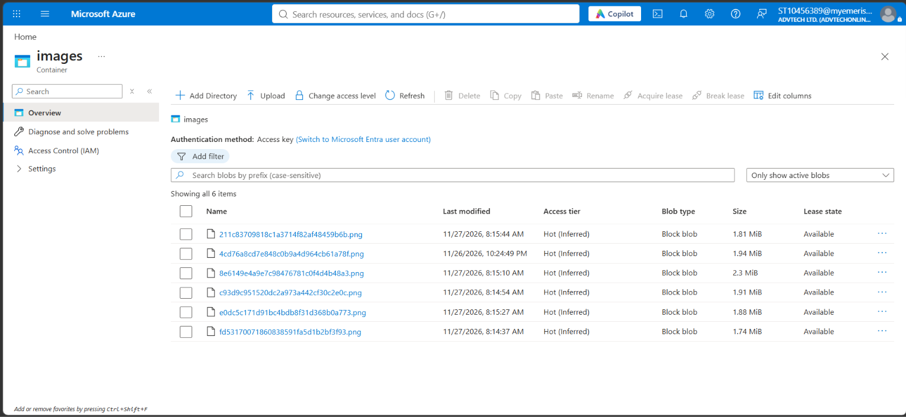

**Contract in Azure Files**

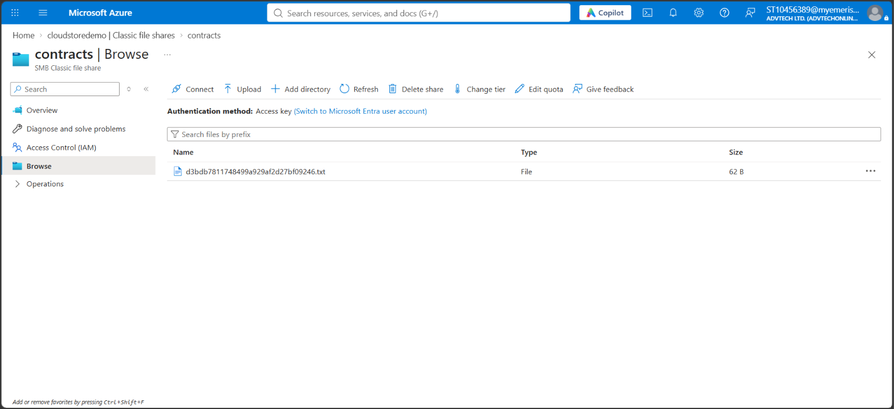

**Queue-trigger executions**

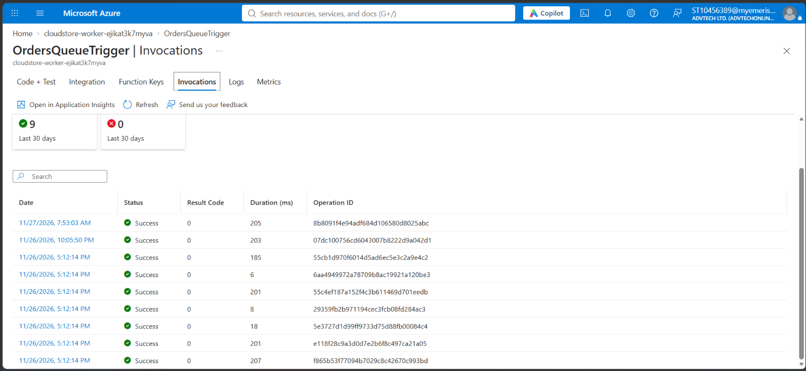

**Web and worker telemetry**

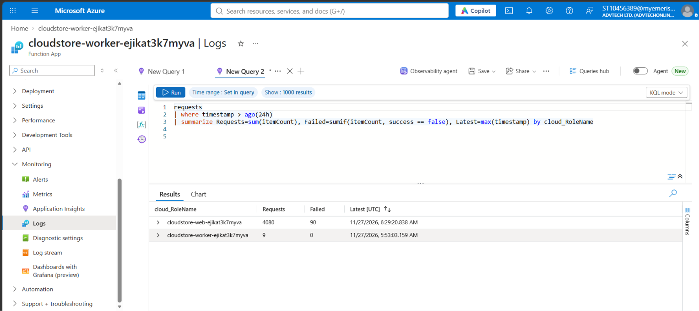

**Enabled alert rules**

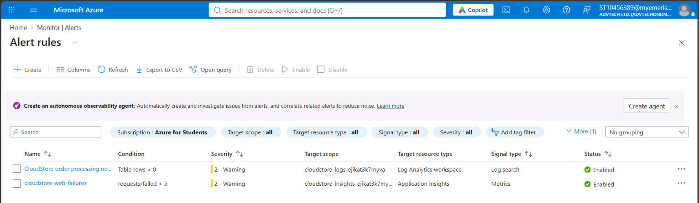

**Monthly budget**

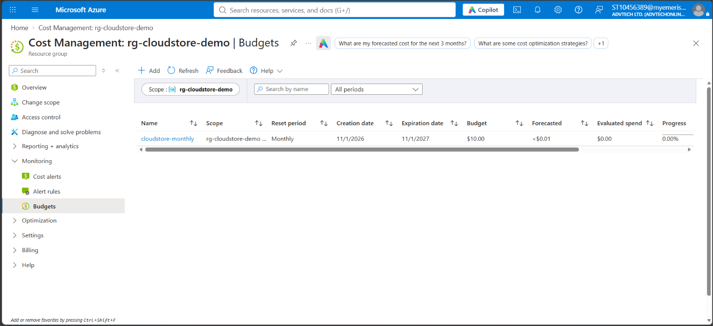

</details>

<details>
<summary>See the login and administrator interface</summary>

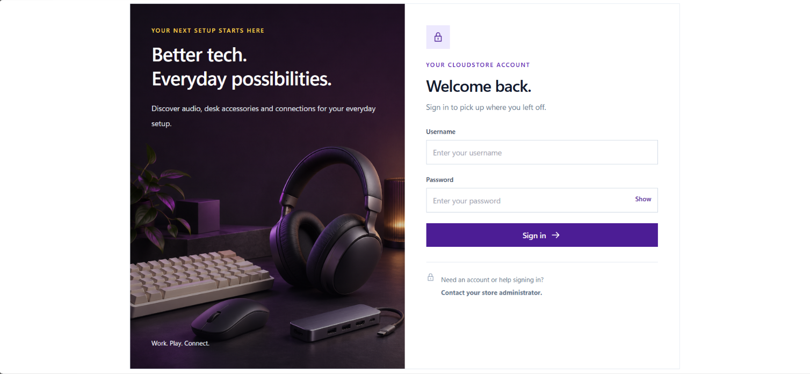

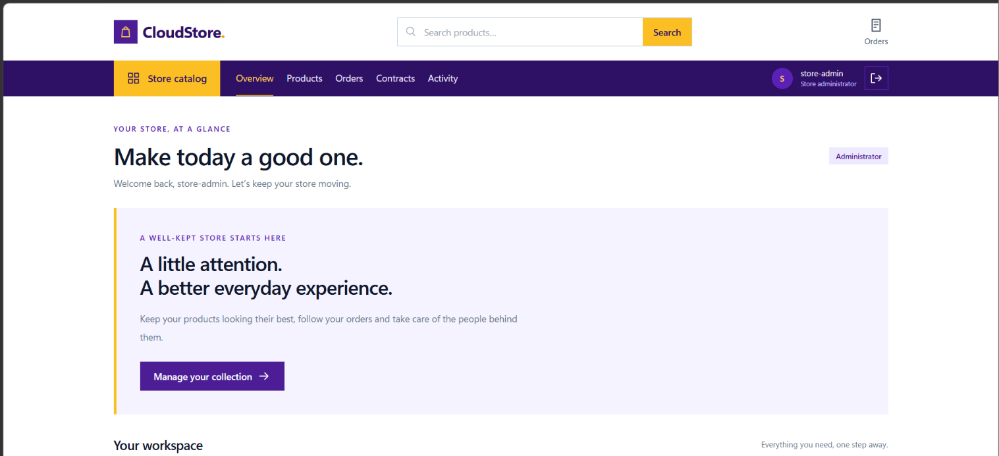

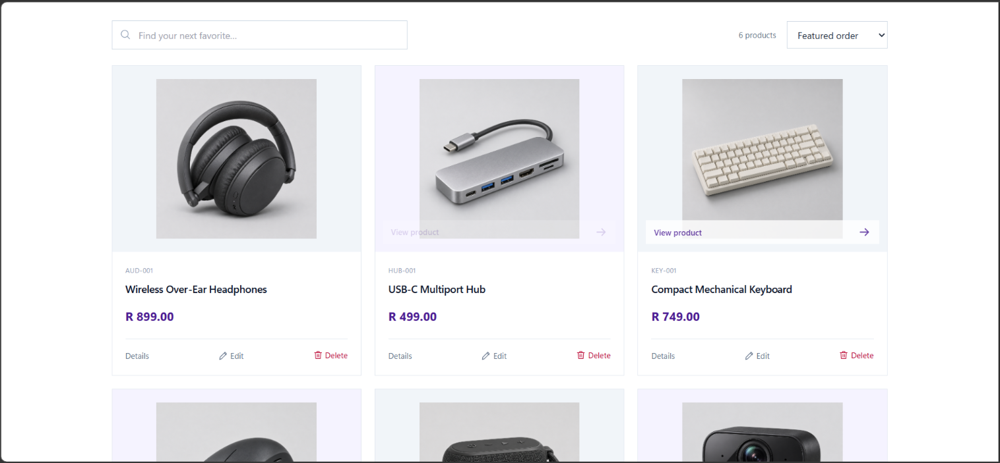

</details>

## Verification

Run the repository verification script from PowerShell:

```powershell
./scripts/Verify.ps1
```

It restores, builds and runs the automated test suite. Tests cover account setup and session invalidation, authorization, upload validation, checkout and order transitions, local storage and Azure operation adapters. Optional Bicep validation is documented in [RUNNING.md](RUNNING.md). Automated tests complement the captured live customer-to-administrator workflow; they do not establish production readiness or email delivery.

## Repository layout

```text
src/CloudStore.Web/         MVC application and storage adapters
src/CloudStore.Functions/   Isolated Functions worker
src/CloudStore.Shared/      Shared models and order rules
tests/CloudStore.Tests/     Automated tests
infra/                     Bicep templates and parameter files
database/                  SQL setup and restricted identity access
monitoring/                Monitoring templates and queries
scripts/                   Verification and maintenance utilities
sample-data/catalog/       Sample images and manifest
docs/images/               Application and Azure screenshots
RUNNING.md                 Detailed setup and operations guide
```

## Credits

The interface adapts the **MayBell / Tailwind E-commerce** theme by Bogdan Bulakh from [bbulakh/tailwind-ecommerce, branch `2.x`](https://github.com/bbulakh/tailwind-ecommerce/tree/2.x). CloudStore integrates the theme into ASP.NET Core Razor views and builds its CSS locally with Tailwind CSS. Its [MIT license](src/CloudStore.Web/wwwroot/lib/maybell/LICENSE), [Tailwind license](src/CloudStore.Web/wwwroot/lib/maybell/TAILWIND-LICENSE) and [source attribution](src/CloudStore.Web/wwwroot/lib/maybell/SOURCE.txt) are retained. Product and promotional imagery is synthetic, AI-generated demonstration artwork; it does not represent manufacturer endorsements or real offers.
